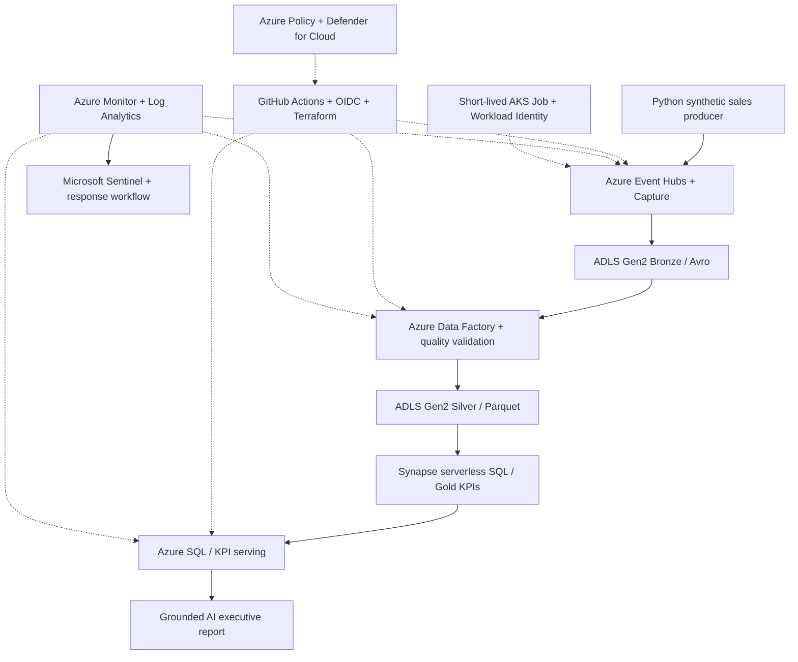

# Azure Secure Sales Intelligence Platform

**Azure | Terraform | DevSecOps | Microsoft Sentinel | Observability | Data Engineering | AI**

An end-to-end reference implementation of a secure, observable sales intelligence platform. Synthetic sales events travel through governed ingestion, data-quality controls, lake analytics, and a small SQL serving layer to generate evidence-grounded business reports. Infrastructure, access, policy, detection, and operations are managed as one platform.

> **Current status: architecture and Codex engineering scaffold.** Each capability will be marked implemented and verified only after its code and deployment evidence are available. No cloud deployment is represented as complete yet.

## Business value

| Need | Platform outcome |
| --- | --- |
| Trustworthy sales reporting | Validated sales KPIs by region, channel, and time window; data quality and freshness are visible |
| Repeatable delivery | Terraform modules and GitHub Actions with OIDC-based Azure authentication |
| Risk reduction | Least-privilege identity, Checkov/Gitleaks, Azure Policy and Defender for Cloud posture checks |
| Security response | Microsoft Sentinel detects controlled configuration changes and supports incident triage and a reviewed correction |
| Reliable operation | Azure Monitor alerts, runbooks, failure drills and measured recovery |
| Clear executive insights | Azure AI-generated summary references real SQL KPI values, timestamps and quality caveats |

## Architecture

The platform uses **Event Hubs Capture** for raw ingestion, **ADF** for controlled data transformation, **Synapse serverless SQL** for lake queries, **Azure SQL** for application-ready KPI serving, **Azure Monitor** for reliability signals, and **Microsoft Sentinel** for security analytics. The AKS producer exercise demonstrates Kubernetes workload identity with the same synthetic event contract. Each choice connects to an operational or business requirement; see [architecture decisions](docs/decisions/0001-integrated-platform.md).

The ingestion layer handles events promptly, while Capture, ADF and downstream reporting run in stages. Report freshness is measured and exposed.

## Delivery roadmap

| Phase | Demonstrable milestone | Status |
| --- | --- | --- |
| 1 | Secure Terraform baseline, CI security gates and Sentinel activity ingestion | Planned |
| 2 | Bounded event batch successfully captured as Bronze Avro; AKS producer exercise | Planned |
| 3 | Auditable data-quality pipeline to Silver Parquet | Planned |
| 4 | Verified Gold-to-Azure-SQL KPI serving and Azure governance | Planned |
| 5 | Executive AI brief grounded in a verified SQL snapshot | Planned |
| 6 | Operational workbook, actual Sentinel test incident, response and end-to-end demo | Planned |

Milestones become **Verified** only when reproducible commands, sanitized evidence and measured cloud outcomes support the claim. Progress and known limitations are tracked in [PLANS.md](PLANS.md) and [evidence/](evidence/README.md).

## Explore the engineering work

- [System architecture and data flow](docs/architecture/OVERVIEW.md)
- [Event, KPI and provenance contracts](docs/architecture/DATA_CONTRACT.md)
- [Architecture decision records](docs/decisions/0001-integrated-platform.md)
- [Recruiter-friendly project walkthrough](docs/PROJECT_WALKTHROUGH.md)
- [Runbooks](docs/runbooks/) and [phase evidence](evidence/README.md) as they are added

## Reproducing the implementation

The repository is organized for Terraform-based provisioning and reproducible testing. Setup commands, Azure prerequisites, and phase-specific deployment steps will be recorded with the corresponding implemented code. Cloud writes remain approval-gated; time-boxed test sessions include measured cost and teardown evidence.

## Documentation and origins

The initial six-phase sales analytics concept was inspired by the *Real-Time Sales Intelligence Platform* learning guide by Jhante Charles. This project extends the design into integrated cloud platform engineering, security automation and operations, with original implementation work, tests and demonstrations documented as they are created. Synthetic data is used throughout.
